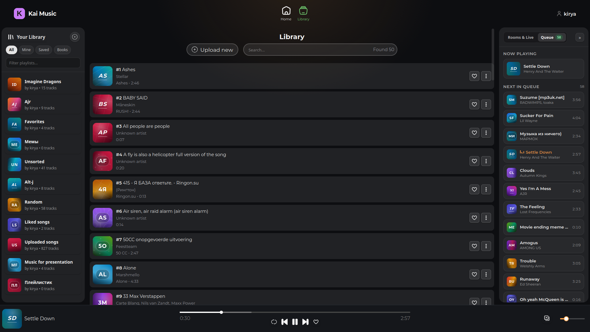
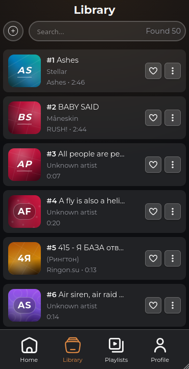
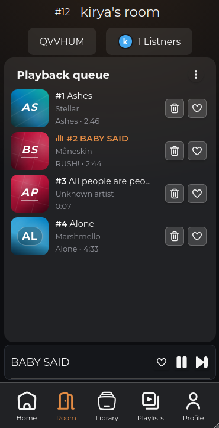
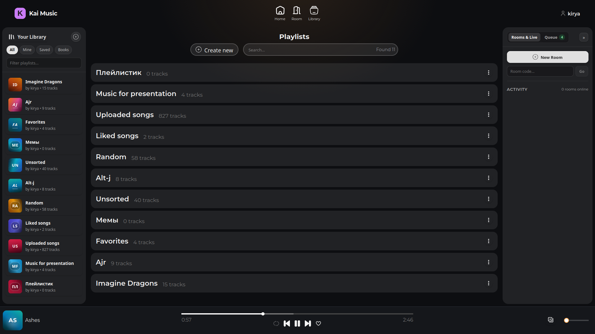
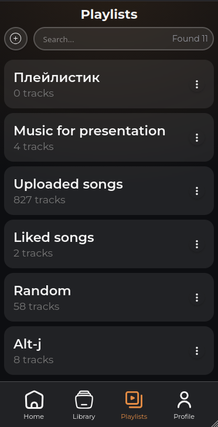

<div align="center">

# Kai Music

### Project


### Frontend


### Backend


### Infrastructure


[English](#) · [Suomi](docs/fi/README.md)

Real-time synchronized music streaming platform where users join shared rooms, browse a music library, and listen to audio together with low-latency chunk delivery.

</div>


## Overview

Kai Music is a music platform that combines personal audio storage, music streaming, and synchronized group listening.

Users can upload and manage their personal music collections, publish audio to a shared moderated catalog, and discover music uploaded by other members.

The platform's key feature is synchronized listening rooms, where users can join together and listen to the same tracks with synchronized playback across all participants.

## Screenshots

### Music Library

<div align="center">
    
    
</div>

### Listening Room

<div align="center">
    
    
</div>

### Playlists

<div align="center">
    
    
</div>

## Features

### Music Management
- Upload and store personal audio files.
- Browse and listen to your personal music library.
- Edit audio metadata and track information.
- Publish tracks to the shared music catalog.
- Music recognition by AСRCloud

### Music Discovery
- Browse and search the shared music catalog.
- Discover audio uploaded by other users.

### Playlists & Playback
- Create and manage personal playlists.
- Automatically collect liked tracks in a dedicated playlist.
- Add individual tracks or entire playlists to the playback queue.
- Control the playback queue.
- Repeat and shuffle playback.

### Listening Rooms
- Create listening rooms and invite other users.
- Listen to music together in real time.
- Keep playback synchronized across all room participants.

### Progressive Web App (PWA)
- Install Kai Music as an application on supported devices.
- Access the platform through a standalone app-like experience.
- Use a responsive interface optimized for desktop and mobile devices.

## Architecture Overview

Kai Music uses a modular backend architecture and a component-based React frontend. The application is organized into independent functional modules with clearly defined responsibilities, while communication between modules is handled through direct service calls and Spring Application Events.

### Backend Architecture

The backend is built with Java and Spring Boot using a Maven multi-module structure.

Each functional module follows a layered architecture that separates business logic from application workflows and external interfaces:

- **Domain** — contains business models, domain logic, and application state representations.
- **Application** — implements application workflows through commands, handlers, and services.
- **Presentation** — exposes functionality through REST controllers and WebSocket handlers.

Dependencies follow the direction `Presentation → Application → Domain`, keeping business logic independent of external interfaces.

#### Functional Modules

| Module | Responsibility |
|---|---|
| `user` | User management and user-related operations. |
| `storage` | Integration with Cloudflare R2 through its S3-compatible API. |
| `room` | Listening room management. |
| `presence` | Real-time user presence tracking, including online/offline status and active connections. |
| `playlist` | Personal playlist management and room playback queue operations. |
| `playback` | Playback orchestration, audio streaming, synchronization, and playback session management. |
| `permission` | Role and permission management. |
| `authorization` | User authentication, registration, login, and JWT issuance through cookies. |
| `audio` | Audio management, metadata operations, and audio recognition through ACRCloud. |

#### Infrastructure Modules

| Module | Responsibility |
|---|---|
| `security` | Security configuration, HTTP and WebSocket authentication, JWT handling, encryption, and permission services. |
| `security-core` | Shared security abstractions, annotations, interfaces, domain objects, and exceptions used across backend modules. |
| `diagnostics` | Application-wide runtime diagnostics and terminal commands for monitoring application state and services. |
| `common` | Shared application configuration and inter-module event definitions. |

### Playback Engine

The `playback` module contains the most complex application logic. It coordinates playback across individual users and listening rooms.

Its responsibilities include:

- Managing playback states and session snapshots.
- Maintaining runtime playback contexts.
- Processing playback commands and state transitions.
- Streaming audio chunks to connected users.
- Synchronizing playback between listening room participants.
- Managing streaming workers and listener connections.
- Distributing audio data and playback state updates through WebSockets.

#### Playback Context Management

Playback state is separated into several models with distinct responsibilities:

| Model | Responsibility |
|---|---|
| `PlaybackState` | Stores playback state for a specific target, such as a user or listening room. |
| `UserPlayback` | Associates a user with their current playback target. |
| `RoomPlaybackContext` | Maintains the runtime playback context for a listening room. |

This separation allows personal playback and room playback to operate independently while sharing the same playback infrastructure.

Each connected listener also has an individual streaming context. This allows users to receive audio starting from their current playback position without requiring every participant to share the same streaming buffer.

#### Audio Streaming Architecture

Kai Music uses server-controlled fragmented MP4 streaming over WebSockets, with Media Source Extensions (MSE) handling playback in the browser.

The streaming pipeline:

```text
Audio Storage
    ↓
FFmpeg (AAC Encoding)
    ↓
Fragmented MP4
    ↓
Chunk Worker
    ↓
WebSocket
    ↓
Frontend
    ↓
Media Source Extensions (MSE)
    ↓
Audio Output
```

The streaming process works as follows:

1. Audio files are retrieved from object storage.
2. FFmpeg encodes audio into AAC and produces fragmented MP4 data.
3. The backend divides the output into chunks and manages their delivery.
4. Audio chunks are transmitted to connected users through WebSockets.
5. The frontend appends received chunks to a MediaSource using a SourceBuffer.
6. The browser decodes and plays the buffered audio.

Each listener has an individual streaming context responsible for chunk sequencing, initialization data, and buffer management. This allows listeners to join ongoing playback at different positions while maintaining synchronized playback within a listening room.

### Persistent and Runtime State

The application separates persistent data from runtime state.

**Persistent State** is stored in MariaDB and includes:

- User accounts and related data.
- Audio metadata.
- Personal playlists and listening room queues.
- Listening rooms.
- Playback state and user playback relationships.

**Runtime State** is maintained in application memory and includes:

- Active playback contexts.
- Connected listening room participants.
- Individual audio streaming contexts.
- Active streaming workers.
- WebSocket connection state.

This separation keeps temporary connection and streaming data out of the persistent data model while allowing the application to manage active playback sessions independently.

### Frontend Architecture

The frontend is built with React and TypeScript using a component-based architecture.

Its main characteristics include:

- Reusable UI components with clearly separated responsibilities.
- SCSS Modules for component-level styling and style isolation.
- Separate API integrations for backend modules that expose external endpoints.
- WebSocket communication for real-time playback updates and audio streaming.
- Custom playback hooks for managing media sources, audio buffers, and playback state.
- Virtualized lists for efficient rendering of large music libraries.
- Playwright for automated browser testing.

### Inter-Module & Client Communication

The application uses three primary communication mechanisms:

- **Direct Service Calls** — backend modules call services from other modules when permitted by the module dependency structure.
- **Spring Application Events** — used to publish events that trigger operations across multiple modules or to send signals from a dependent module back to the module it depends on.
- **WebSockets** — provide bidirectional real-time communication between the backend and frontend, handling playback synchronization, audio delivery, and live state updates.

This combination keeps module dependencies controlled while supporting decoupled event-driven workflows and real-time client communication.

## Project Structure

```text
Kai/
├── Backend/
│   ├── application/
│   ├── common/
│   ├── infrastructure/
│   │   ├── diagnostics/
│   │   ├── security/
│   │   └── security-core/
│   └── modules/
│       ├── audio/
│       ├── authorization/
│       ├── permission/
│       ├── playback/
│       ├── playlist/
│       ├── presence/
│       ├── room/
│       ├── storage/
│       └── user/
├── Frontend/
│   ├── public/
│   ├── src/
│   │   ├── assets/
│   │   ├── components/
│   │   ├── css/
│   │   ├── lib/
│   │   └── pages/
│   └── tests/
├── TelegramBot/
│   └── app/
├── Database/
├── Nginx/
│   └── conf.d/
├── docs/
│   ├── screenshots/
│   └── fi/
├── compose.yaml
├── deploy.sh
└── README.md
```

### Main Directories

| Directory | Description |
|---|---|
| `Backend/` | Java Spring Boot backend, organized as a Maven multi-module project. |
| `Frontend/` | React application built with TypeScript and Vite. |
| `TelegramBot/` | Telegram bot for uploading audio files to Kai Music. |
| `Database/` | Database initialization scripts. |
| `Nginx/` | Nginx configuration and reverse proxy setup. |
| `docs/` | Project documentation, reports, and screenshots. |
| `compose.yaml` | Docker Compose configuration for application services. |
| `deploy.sh` | Deployment script. |

## Deployment Architecture

Kai Music uses Docker and Docker Compose to build, deploy, and manage its application services.

### Infrastructure

The production environment consists of the following services:

| Service | Responsibility |
|---|---|
| `kai-backend` | Spring Boot backend application. |
| `kai-backend-db` | MariaDB database for the main application. |
| `kai-bot-db` | MariaDB database for the Telegram bot. |
| `kai-frontend` | Frontend application. |
| `kai-nginx` | Nginx reverse proxy handling external HTTP and WebSocket traffic. |

Each service runs in its own container and communicates with other services through the Docker network.

### Network Architecture

Nginx acts as the public-facing entry point for the application.

It handles incoming HTTP and WebSocket connections and routes requests to the appropriate services.

The backend application and database services are not intended to expose their internal ports directly to the public internet. Internal communication between containers is handled through the Docker network.

### Deployment Process

The project includes a deployment script (`deploy.sh`) that automates the build and deployment process.

The deployment process includes:

1. Building the frontend application.
2. Building the backend using Maven.
3. Building the required Docker images.
4. Starting or updating application containers through Docker Compose.

The deployment script handles the application build and service deployment, reducing the need to execute these steps manually.

### Database Management

The application uses separate MariaDB instances for the main backend and Telegram bot.

Database persistence is managed independently of the application container lifecycle. Recreating or updating application containers does not replace the persistent database data.

Database backups and migrations should be handled separately from application deployment.

### Environment Configuration

Deployment configuration is managed through environment variables.

Sensitive credentials and service-specific settings are stored in the `.env` file and provided to the corresponding containers at runtime.

See the [Configuration](#configuration) section for details.

## Getting Started

### Prerequisites

- Git
- Docker and Docker Compose

### Installation

1. Clone the repository:
    ```bash
    git clone <repository-url>
    cd Kai
    ```

2. Create the environment file:
    ```bash
    cp .env.example .env
    ```

3. Configure the required environment variables in `.env`.

4. Run the deployment script:
    ```bash
    ./deploy.sh
    ```

The deployment script automatically builds all application components and deploys the services using Docker Compose.

## Configuration

Before deployment, copy `.env.example` to `.env` and configure the required environment variables.

The configuration includes:

| Category | Variables | Description |
|---|---|---|
| Backend Database | `BACKEND_DB_*` | Backend database credentials and configuration. |
| Bot Database | `BOT_DB_*` | Telegram bot database credentials and configuration. |
| Telegram Bot | `BOT_TOKEN`, `BOT_USERNAME` | Telegram bot credentials and username. |
| Application URLs | `FRONTEND_URL`, `BACKEND_URL`, `APP_DOMAIN` | Frontend, backend, and application domain configuration. |
| Object Storage | `S3_*` | S3-compatible storage endpoint, bucket, and access credentials. |
| Audio Recognition | `ACRCLOUD_*` | ACRCloud API credentials and host configuration. |

Replace all placeholder values with your actual configuration. Keep `.env` private and never commit it to the repository.

See `.env.example` for the complete list of required environment variables.

## Roadmap

- **Administration Panel** — introduce centralized application management with administrative controls over the platform.
- **Smart Playlists** — generate playlists based on mood, genre, interests, and other preferences.
- **Listening Room Improvements**
    - Introduce access control to prevent unauthorized users from interfering with room playback or settings.
    - Allow room owners to manage participant permissions.
    - Support permanent and temporary listening rooms.
- **Audiobook Catalog** — expand the platform with a dedicated catalog for audiobooks.

## Contributing

Contributions, bug reports, and feature suggestions are welcome.

Feel free to open an issue to report a problem or discuss a proposed improvement. Pull requests are also welcome.

## License

This project is licensed under the [MIT License](LICENSE). See the [LICENSE](LICENSE) file for details.