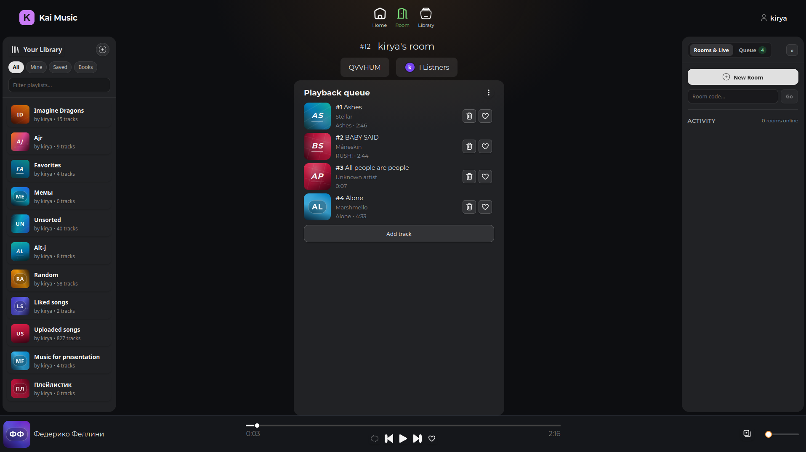

<div align="center">

# Kai Music

### Project


### Frontend


### Backend


### Infrastructure


[English](#) · [Suomi](docs/fi/README.md)

Real-time synchronized music streaming platform where users join shared rooms, browse a music library, and listen to audio together with low-latency chunk delivery.

</div>


## Overview

Kai Music is a music platform that combines personal audio storage, music streaming, and synchronized group listening.

Users can upload and manage their personal music collections, publish audio to a shared moderated catalog, and discover music uploaded by other members.

The platform's key feature is synchronized listening rooms, where users can join together and listen to the same tracks with synchronized playback across all participants.

## Screenshots

### Music Library

<div align="center">
    
    
</div>

### Listening Room

<div align="center">
    
    
</div>

### Playlists

<div align="center">
    
    
</div>

## Features

### Music Management
- Upload and store personal audio files.
- Browse and listen to your personal music library.
- Edit audio metadata and track information.
- Publish tracks to the shared music catalog.
- Music recognition by ARCloud

### Music Discovery
- Browse and search the shared music catalog.
- Discover audio uploaded by other users.

### Playlists & Playback
- Create and manage personal playlists.
- Automatically collect liked tracks in a dedicated playlist.
- Add individual tracks or entire playlists to the playback queue.
- Control the playback queue.
- Repeat and shuffle playback.

### Listening Rooms
- Create listening rooms and invite other users.
- Listen to music together in real time.
- Keep playback synchronized across all room participants.

## Architecture Overview

Kai Music uses a modular backend architecture and a component-based React frontend. The application is organized into independent functional modules with clearly defined responsibilities.

### Backend Architecture

The backend is built with Java and Spring Boot using a Maven multi-module structure.

**Functional Modules**

| Module | Responsibility |
|---|---|
| `user` | User management and user-related operations. |
| `storage` | Integration with Cloudflare R2 through its S3-compatible API. |
| `room` | Listening room management. |
| `presence` | Real-time user presence tracking (online/offline status). |
| `playlist` | Playlist management and operations. |
| `playback` | Playback orchestration, audio streaming, synchronization, and playback session management. |
| `permission` | Role and permission management. |
| `authorization` | User authentication, registration, login, and JWT issuance through cookies. |
| `audio` | Audio management, metadata operations, and audio recognition through ACRCloud. |

**Infrastructure Modules**

| Module | Responsibility |
|---|---|
| `security` | Security configuration, HTTP and WebSocket authentication, JWT handling, encryption, and permission services. |
| `security-core` | Shared security abstractions, annotations, interfaces, domain objects, and exceptions used across backend modules. |
| `diagnostics` | Application-wide runtime diagnostics and terminal commands for monitoring application state and services. |
| `common` | Shared application configuration and inter-module event definitions. |

**Playback Engine**

The `playback` module contains the most complex application logic. It is responsible for:

- Managing playback states and session snapshots.
- Maintaining runtime playback contexts.
- Processing playback commands and state transitions.
- Streaming audio chunks to connected users.
- Synchronizing playback between listening room participants.
- Managing WebSocket connections and distributing audio data and playback state updates.

### Frontend Architecture

The frontend is built with React and TypeScript.

- Component-based architecture with reusable UI components.
- SCSS Modules for component-level styling and style isolation.
- Separate API integrations for backend modules that expose external endpoints.
- WebSocket communication for real-time playback updates and audio streaming.
- Playwright for automated browser testing.

### Inter-Module & Client Communication

The application uses three primary communication mechanisms:

- **Direct Service Calls** — backend modules call services from other modules when permitted by the module dependency structure.
- **Spring Application Events** — used to publish events that trigger operations across multiple modules or to send signals from a dependent module back to the module it depends on.
- **WebSockets** — provide bidirectional real-time communication between the backend and frontend, handling playback synchronization, audio delivery, and live state updates.

This combination keeps module dependencies controlled while supporting decoupled event-driven workflows and real-time client communication.

## Project Structure

```text
Kai/
├── Backend/
│   ├── application/
│   ├── common/
│   ├── infrastructure/
│   │   ├── diagnostics/
│   │   ├── security/
│   │   └── security-core/
│   └── modules/
│       ├── audio/
│       ├── authorization/
│       ├── permission/
│       ├── playback/
│       ├── playlist/
│       ├── presence/
│       ├── room/
│       ├── storage/
│       └── user/
├── Frontend/
│   ├── public/
│   ├── src/
│   │   ├── assets/
│   │   ├── components/
│   │   ├── css/
│   │   ├── lib/
│   │   └── pages/
│   └── tests/
├── TelegramBot/
│   └── app/
├── Database/
├── Nginx/
│   └── conf.d/
├── docs/
│   ├── screenshots/
│   └── fi/
├── compose.yaml
├── deploy.sh
└── README.md
```

### Main Directories

| Directory | Description |
|---|---|
| `Backend/` | Java Spring Boot backend, organized as a Maven multi-module project. |
| `Frontend/` | React application built with TypeScript and Vite. |
| `TelegramBot/` | Telegram bot for uploading audio files to Kai Music. |
| `Database/` | Database initialization scripts. |
| `Nginx/` | Nginx configuration and reverse proxy setup. |
| `docs/` | Project documentation, reports, and screenshots. |
| `compose.yaml` | Docker Compose configuration for application services. |
| `deploy.sh` | Deployment script. |